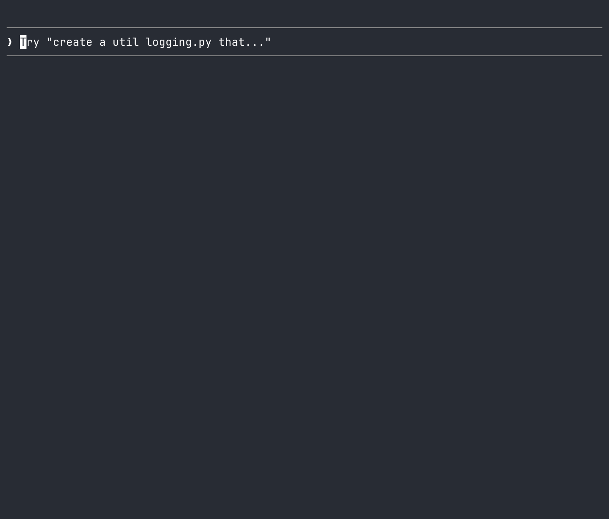
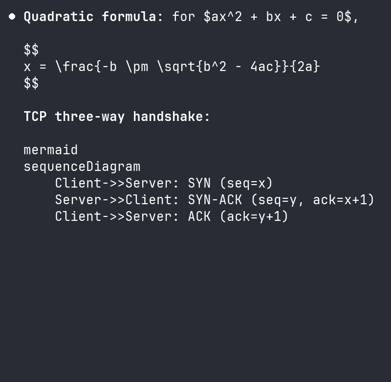
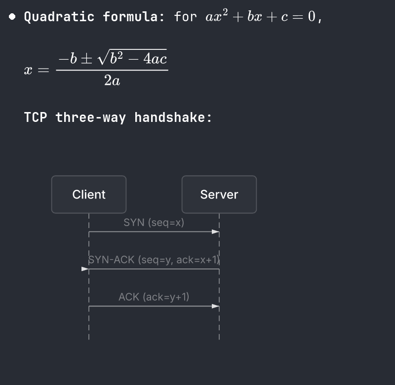
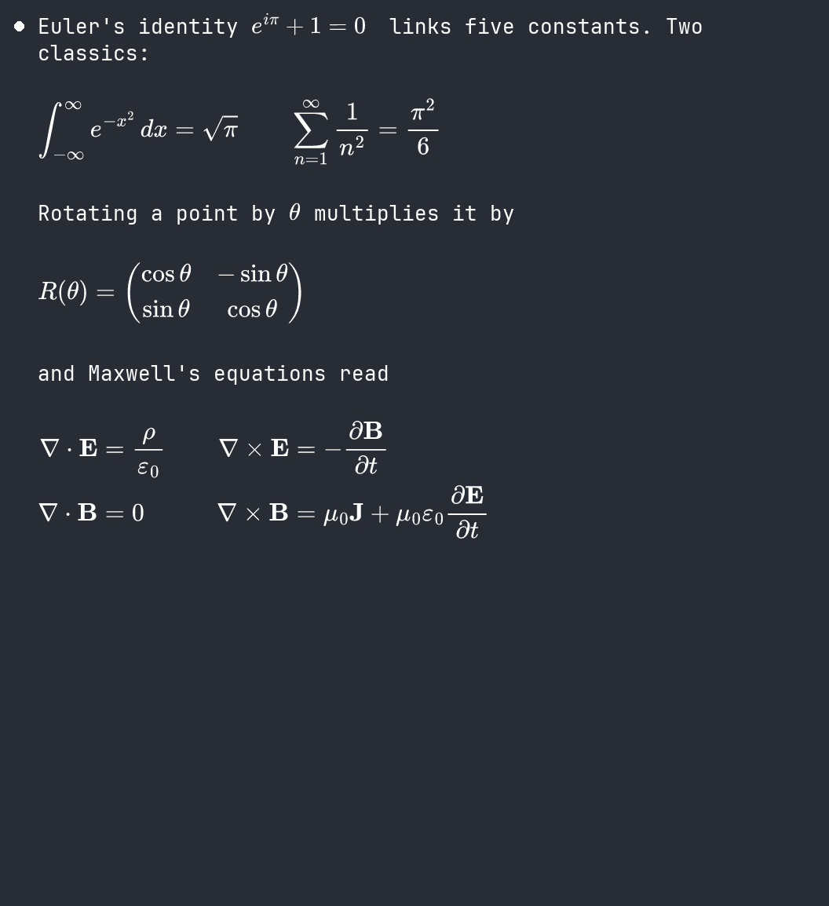
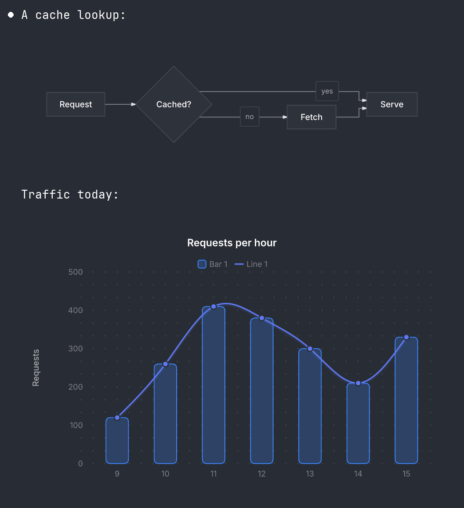

# Agent Visuals

A Claude Code plugin that draws LaTeX math and Mermaid diagrams in replies as images, and asks the model to write them.



| Before | After |
| --- | --- |
|  |  |

- Display math: `$$` or `\[` blocks on lines of their own.
- Inline math: `$...$` or `\(...\)` in paragraphs and list items, as one-row images. Formulas too tall for a row, and math in headings, tables and quotes, become Unicode text.
- Diagrams: ` ```mermaid ` blocks with flowcharts, sequence, class, state, ER and xy charts. Other types, such as pie and gantt, stay code.

 

## Install

At a Claude Code prompt:

```
/plugin install agent-visuals --marketplace latekvo/agent-visuals
```

or from a shell: `claude plugin marketplace add latekvo/agent-visuals && claude plugin install agent-visuals@agent-visuals`.

Needs `node` and a terminal with the kitty graphics protocol (Ghostty, kitty). Inside tmux, turn on `allow-passthrough` and `focus-events`. Elsewhere formulas show as text. `AGENT_VISUALS_FG` sets the drawing color (default `#ffffff`); `AGENT_VISUALS_BG` sets the diagram background, best matched to the terminal's (default `#282c34`, Ghostty's).

## Development

`claude --plugin-dir .` runs a session with this checkout loaded; `claude plugin test .` runs the tests.

`renderer/dist/` is built from `renderer/src.mjs` and committed, so installs need no build step: `cd renderer && npm ci && npm run build`.

The renderer takes JSON on stdin and writes PNGs as base64 on stdout, with nothing Claude-specific in it; the Claude Code adapter is `hooks/`.

## License

MIT. `renderer/dist/` bundles third-party code; its licences are in `renderer/dist/LICENSES.txt`. The fonts in `renderer/fonts/` are under the SIL Open Font License, beside them.
